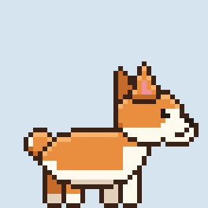

# 🐕 Biscuit, the desktop corgi

A pixel-art corgi that lives on your screen. It walks along the taskbar, climbs
screen edges, naps when you're away, chases your cursor, stands on window
title bars, and keeps you company while you work.



## Run it

```bash
pip install -r requirements.txt      # or just: pip install PySide6
python main.py
```

Options: `--scale 4` (bigger corgi), `--qt PyQt6` (force PyQt6), `--reset`
(forget saved mood), `--debug` (print state changes).

Quit from the right-click menu, the tray icon, or Ctrl+C in the terminal.

## Playing with Biscuit

| Do this | Biscuit does |
|---|---|
| Click | barks and says something |
| Double-click, or wiggle the mouse back and forth over it | gets petted: hearts, happy face |
| Drag | dangles from your cursor |
| Drag and let go mid-swing | gets thrown, with physics. Big falls make it dizzy |
| Right-click | menu: treat, pet, play, nap, mood, Pomodoro, settings |
| Leave the computer for 5 min | curls up and sleeps (Zzz), wakes when you return |

## Everything it does

**Basics:** idle animation with tail wags and blinks; walks the bottom of the
screen; drag, drop and throw with gravity, wall bounces and landing squash.

**Behaviours:** random choices between idling, walking, sitting, yawning,
napping, getting excited and trotting after your cursor. The choices depend
on its mood.

**Aware of your screen:** stands on and walks along the top edges of open
windows (and falls off the end), climbs the left and right screen edges and
then lets go, chases your cursor (menu → Play, or Settings → Always follow).

**Reacts to your computer:**
- Fast typing (≥ 280 keys/min) → excited bouncing. Uses `pynput`, which only
  counts key presses. It never records which keys you pressed.
- CPU ≥ 85% → sweat drops and panting.
- Battery ≤ 20% and unplugged → droopy ears, sad walk, slower. Cheers up when
  you plug in.

**Useful pet:**
- Water reminder every 45 min, stretch reminder every 60 min (only while
  you're active), and a nudge if you're still up after 1 AM.
- Pomodoro timer (right-click → Pomodoro): countdown bubble, celebrates when a
  focus session ends, starts the break automatically.
- Seat watcher: point it at any URL returning JSON and Biscuit tells you when
  seats open up. Made for the thermal-camera seat project, see below.

**Personality:** happiness, energy and tummy stats that drift over time and
are saved between runs. Treats fill the tummy, petting raises happiness,
naps restore energy. A hungry or sad corgi mopes more, a tired one naps more,
and a happy one plays more. Right-click → "How are you?" shows the stats.

## Settings

Edit `~/.corgi_pet/config.json` (created on first run), or toggle features in
right-click → Settings.

```json
{
  "name": "Biscuit",
  "scale": 3,
  "sleep_after_idle_min": 5,
  "reminders": {"water_min": 45, "stretch_min": 60},
  "pomodoro": {"focus_min": 25, "break_min": 5},
  "typing_excited_kpm": 280,
  "cpu_hot_percent": 85,
  "battery_low_percent": 20
}
```

### Seat watcher

```json
"seat_watcher": {
  "enabled": true,
  "url": "http://your-server/api/seats",
  "value_path": "rooms.0.free",
  "threshold": 1,
  "label": "Main Library 3/F",
  "interval_s": 60
}
```

`value_path` is a dot path into the JSON: for `{"rooms": [{"free": 3}]}` it's
`rooms.0.free`. Biscuit speaks up when the value *rises* to the threshold or
above. A `file:///path/to/seats.json` URL works for testing.

## The art

All 52 frames are drawn in code in `sprites.py`: shapes on a 40×32 grid,
with automatic outlines, shading, and expressions (open, wide, happy ^^,
sad, sleepy, dizzy x eyes; smile, tongue, bark, yawn mouths; upright, flat
and droopy ears). Change a number and every frame updates.

Animations: idle, pant, walk, walk_sad, run, sad, excited, drag, fall, land,
dizzy, sit, yawn, bark, happy, sleep, climb.

To hand-edit frames instead:

```bash
pip install pillow
python export_sprites.py     # writes sprite_export/frames/*.png + sheet + GIF
mkdir custom_sprites
cp sprite_export/frames/idle_0.png custom_sprites/   # edit it in Aseprite/Piskel
```

Any PNG in `custom_sprites/` named `<animation>_<frame>.png` replaces the
generated frame.

## Platform notes and limits

- **Windows:** everything works, including walking on windows. On mixed-DPI
  multi-monitor setups, the window-top positions can be a little off on the
  non-primary monitor.
- **macOS:** walking on windows needs `pyobjc-framework-Quartz`. Typing
  reactions need you to grant Accessibility permission to your terminal or
  Python (System Settings → Privacy & Security → Accessibility). Without it,
  Biscuit just skips that feature.
- **Linux:** works on X11. Walking on windows isn't supported. On Wayland,
  always-on-top, typing detection and global cursor position are restricted
  by the compositor, so expect reduced behaviour.
- Biscuit stays above other windows but never takes keyboard focus.
  Transparent areas around it let clicks through on Windows and macOS.

## Make it a double-click app

```bash
pip install pyinstaller
pyinstaller --noconsole --onefile --name Biscuit main.py
```

## Files

| File | What it is |
|---|---|
| `main.py` | entry point and command-line options |
| `pet.py` | the window, physics, state machine, mouse, menu, effects |
| `sprites.py` | all the pixel art, plus animation speeds |
| `bubble.py` | speech bubble |
| `features.py` | config, mood, reminders, Pomodoro, seat watcher, dialogue |
| `sensors.py` | CPU/battery, idle time, typing speed, window edges |
| `qt_compat.py` | picks PySide6 or PyQt6 |
| `export_sprites.py` | export frames, sprite sheet and GIF |
